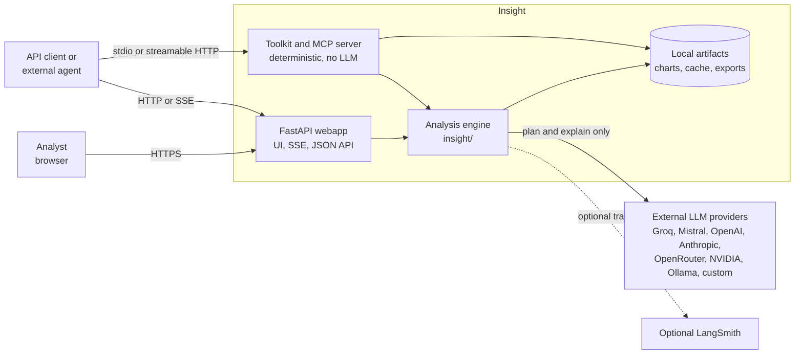
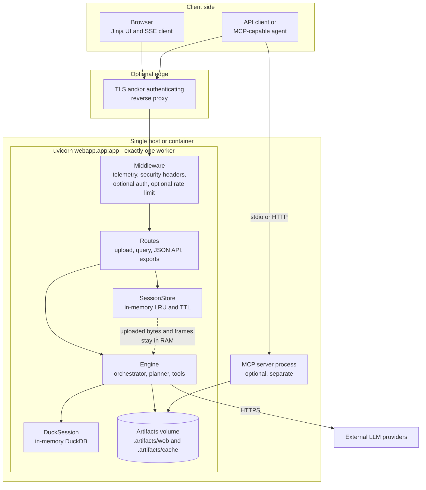
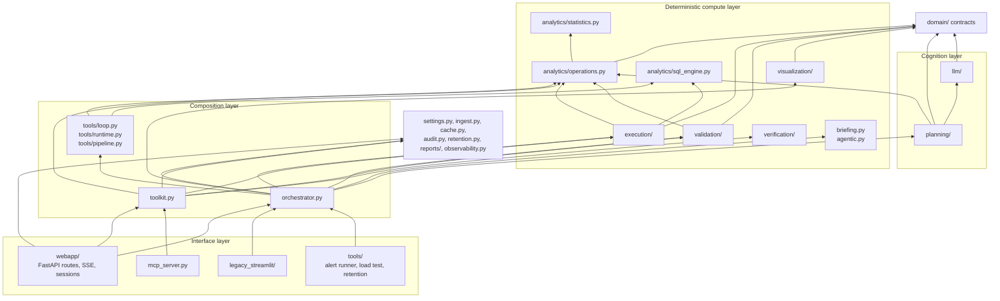
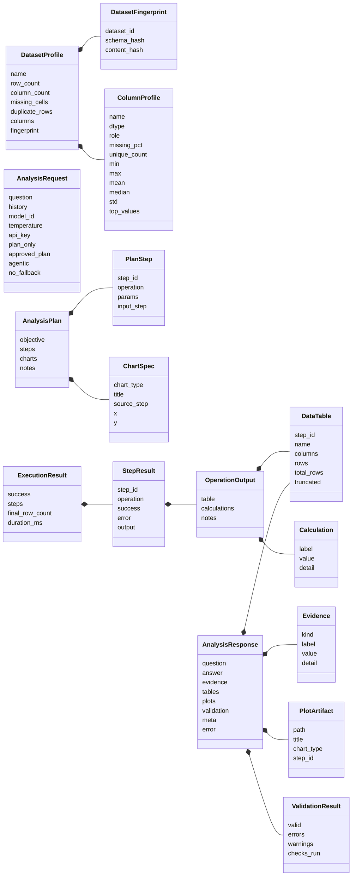
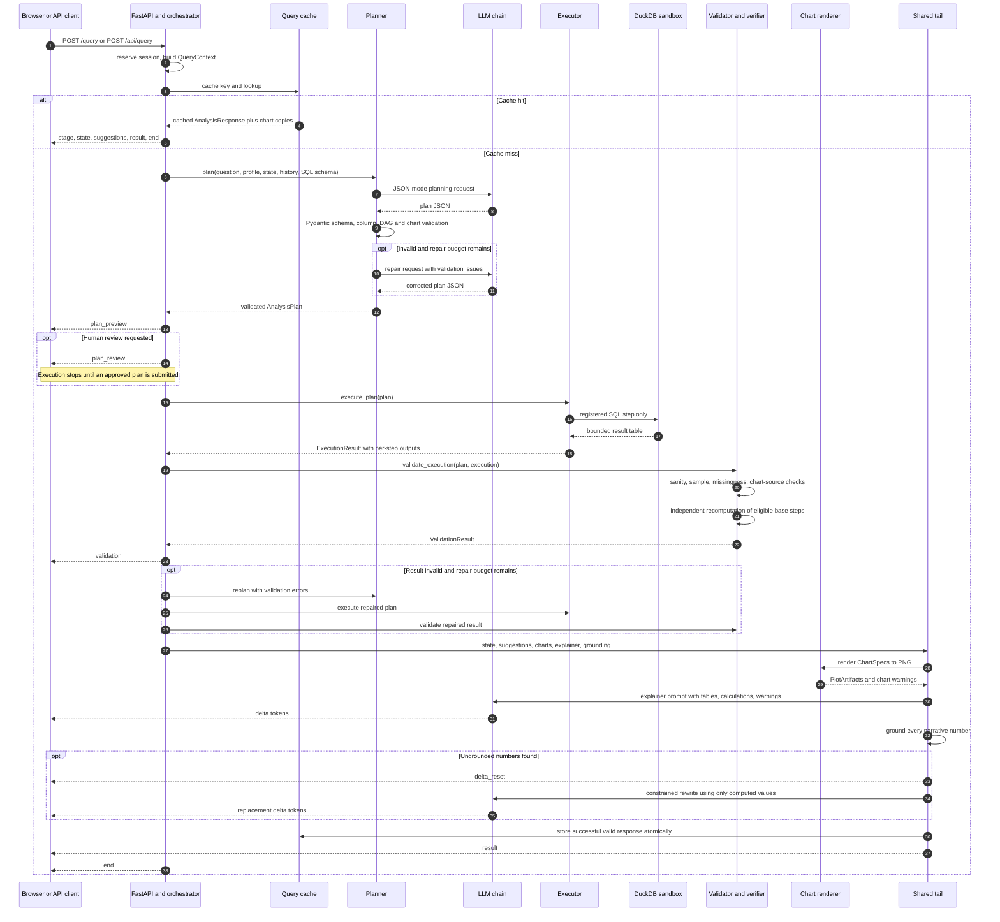
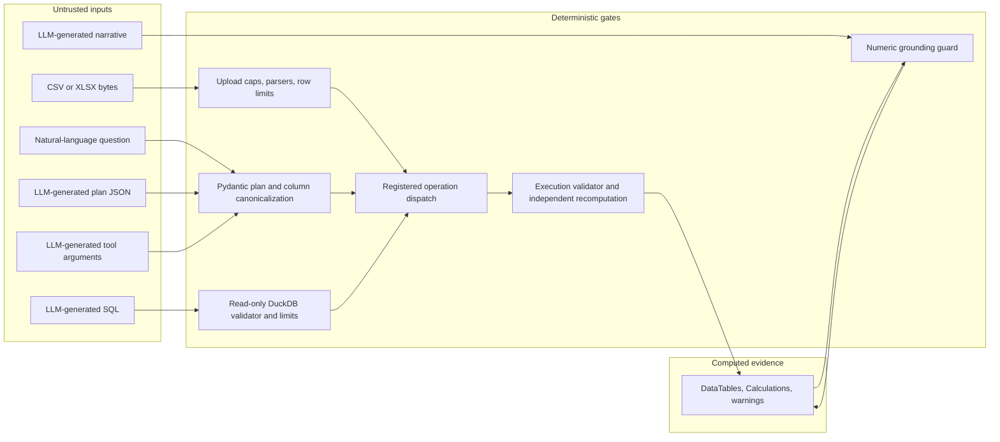
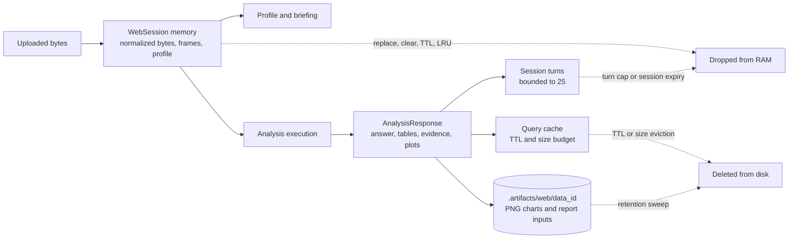

# Insight Architecture

> **Version:** 2.4.0  
> **Scope:** the `insight/` engine, the FastAPI web application, the toolkit/MCP surfaces, and the deployment and supply-chain around them.  
> **Source of truth:** this document is derived from the implementation in `insight/`, `webapp/`, `tools/`, `tests/`, `Dockerfile`, and `.github/workflows/ci.yml`. When code and prose disagree, the code wins.

Insight is a validated, model-agnostic analytical agent for tabular data. Its architecture is organized around a single contract:

> **The LLM plans and narrates. Deterministic code ingests, computes, validates, renders, and verifies every number.**

That contract is not a prompt convention. It is enforced by typed boundaries, a fixed operation registry, a read-only SQL sandbox, a second arithmetic path, and a narration-grounding gate. The LLM cannot execute arbitrary code and cannot make a computed number authoritative.

---

## Contents

- [1. Executive summary](#1-executive-summary)
- [2. System context](#2-system-context)
- [3. Deployment view](#3-deployment-view)
- [4. Codebase and layering](#4-codebase-and-layering)
- [5. Domain contracts](#5-domain-contracts)
- [6. Ingestion, profiling, and briefing](#6-ingestion-profiling-and-briefing)
- [7. Query pipelines](#7-query-pipelines)
- [8. Deterministic computation layer](#8-deterministic-computation-layer)
- [9. LLM control plane](#9-llm-control-plane)
- [10. Trust and validation architecture](#10-trust-and-validation-architecture)
- [11. Interfaces](#11-interfaces)
- [12. Sessions, state, cache, and storage](#12-sessions-state-cache-and-storage)
- [13. Security architecture](#13-security-architecture)
- [14. Observability and operations](#14-observability-and-operations)
- [15. Configuration, deployment, and scaling](#15-configuration-deployment-and-scaling)
- [16. Testing, evaluation, and CI](#16-testing-evaluation-and-ci)
- [17. Design decisions and tradeoffs](#17-design-decisions-and-tradeoffs)
- [18. Failure modes and degradation](#18-failure-modes-and-degradation)
- [19. Extension points](#19-extension-points)
- [20. Known limits and constraints](#20-known-limits-and-constraints)
- [Appendix: glossary](#appendix-glossary)

---

## 1. Executive summary

### 1.1 At a glance

| Attribute | Design |
|---|---|
| **Primary application** | FastAPI app at `webapp.app:app`, served by one uvicorn worker |
| **Engine** | UI-agnostic Python package in `insight/` |
| **Control plane** | LLM planner and explainer behind one provider interface |
| **Data plane** | In-process pandas / NumPy / SciPy plus embedded DuckDB |
| **Default question mode** | Single-shot structured plan, then deterministic execution |
| **Opt-in mode** | Bounded agentic tool-calling loop using the same operations |
| **Primary data input** | CSV and Excel uploads, held in process memory |
| **State** | Cookie-keyed in-memory sessions; optional filesystem query cache |
| **Artifacts** | PNG charts, DOCX reports, dbt/alert descriptors under `.artifacts/` |
| **Verification** | Plan validation, execution checks, independent recomputation, numeric grounding; `verify_claims` emits a versioned certificate with an explicit `grounding` / `recomputed` attestation level |
| **Interfaces** | Browser SSE stream, JSON API, Python engine API, toolkit, MCP server, standalone verifier CLI and local HTTP endpoint, legacy Streamlit |
| **Deployment constraint** | Exactly one worker until session state is externalized |

### 1.2 Architectural invariants

| Invariant | How it is enforced | Primary code |
|---|---|---|
| The LLM never executes code | The planner returns JSON only; the executor accepts only registered operations | `insight/planning/planner.py`, `insight/execution/executor.py` |
| The LLM cannot invent authoritative numbers | Every computed value is produced by pandas/SciPy/DuckDB; narrative numbers are matched back to evidence | `insight/analytics/operations.py`, `insight/validation/grounding.py` |
| Every plan is checked before execution | Pydantic schema validation, operation lookup, column canonicalization, DAG checks, chart-source checks | `insight/domain/analysis.py`, `insight/analytics/operations.py` |
| All LLM output is untrusted | Plans, SQL, tool arguments, and narratives each pass a deterministic gate | `insight/planning`, `insight/analytics/sql_engine.py`, `insight/validation` |
| Agent mode does not get a weaker pipeline | Successful tool calls are rebuilt into an `AnalysisPlan` + `ExecutionResult` and sent through the same validation/render/explain/grounding tail | `insight/tools/pipeline.py`, `insight/orchestrator.py` |
| Failures are visible, not patched with invented output | Validation warnings, fallback deterministic summaries, typed errors, and `meta` diagnostics | `insight/domain/errors.py`, `insight/orchestrator.py` |
| Expensive work is bounded | Plan repair, agent turns/calls, SQL timeout, SQL rows, upload rows/files, session count/turns | `insight/settings.py`, `insight/tools/loop.py`, `insight/analytics/sql_engine.py` |
| The engine is UI-agnostic | FastAPI, Streamlit, toolkit, and MCP all call the same engine surfaces | `insight/orchestrator.py`, `insight/toolkit.py` |

### 1.3 Trust model in one sentence

The **question, upload, LLM plan, LLM SQL, tool arguments, and LLM narrative are untrusted inputs**; the **registered operation registry, DuckDB sandbox, result validator, independent recomputation, and grounding guard are trusted gates**; only computed `DataTable` and `Calculation` values become evidence.

---

## 2. System context



### 2.1 Context boundaries

- **User-facing boundary:** the FastAPI app exposes an HTML UI, an SSE query stream, a JSON query API, export endpoints, and artifact serving. Authentication is optional and opt-in.
- **LLM boundary:** providers are external and untrusted. They receive only the question, dataset profile, schema text, operation catalog, conversation context, execution summaries, and (in agent mode) tool results. They never receive a code-execution capability.
- **Deterministic engine boundary:** `insight/` accepts pandas frames plus typed request objects and returns typed response objects. It does not depend on the web framework.
- **Agent boundary:** `insight/toolkit.py` and `insight/mcp_server.py` expose the deterministic registry and verification directly to external agents. This path makes **no LLM calls**.
- **Persistence boundary:** uploads stay in process memory; generated derivative artifacts may be written to `.artifacts/`. The query cache stores completed responses and chart copies, not the raw uploaded table.

### 2.2 External dependencies

| Dependency | Role | Failure behavior |
|---|---|---|
| LLM provider APIs | Planning, optional tool selection, narration | Provider retries, cross-provider fallback, typed error, deterministic fallback answer |
| pandas / NumPy / SciPy | All tabular and statistical computation | Per-step failure is captured in `ExecutionResult` |
| DuckDB | Relational SQL over registered tables | Sandbox rejects writes; timeout/row cap; operation error surfaces as a failed step |
| Matplotlib (Agg) | Editorial PNG charts | Chart failure becomes a warning; analysis continues |
| python-docx | DOCX report export | Export request fails; analysis data is unaffected |
| Optional LangSmith | Traces and trace URL | Disabled or failed tracing is a no-op |
| Prometheus-compatible scraper | Reads `/metrics` | No built-in alerting stack |

---

## 3. Deployment view



### 3.1 Runtime topology

- **One process, one worker.** `Dockerfile` explicitly starts `uvicorn webapp.app:app` without `--workers`. The comment in the image is a load-bearing architectural constraint: `WebSession` contains uploaded bytes, pandas frames, profile, findings, turns, and analysis state in memory.
- **No shared session store.** A load balancer in front of multiple workers would route different questions to processes that do not share sessions. Horizontal scaling requires externalizing `WebSession` first.
- **Two optional sidecars/processes.** `legacy_streamlit/` is a separate Streamlit front end using the same engine, and `insight.mcp_server` is a separate MCP process. They do not share in-memory sessions with the FastAPI app.
- **Filesystem is derivative storage.** `.artifacts/web/<data_id>/` contains rendered charts and report inputs; `.artifacts/cache/` contains cached responses and chart copies. The app does not write raw uploads to disk.
- **Container runs unprivileged.** The image creates an `insight` user, owns `/app`, and switches to that user before exposing port 8000. The health check calls `/healthz`.
- **Startup work is bounded and best-effort.** The FastAPI lifespan sweeps old web artifacts and launches provider-model discovery in the background. Failure in either does not prevent the app from starting.

### 3.2 Deployment profiles

| Profile | Front end | LLM | State | Intended use |
|---|---|---|---|---|
| Local development | FastAPI or Streamlit | Provider key in `.env` or BYOK | Process memory | Single analyst |
| Single-node container | FastAPI | Provider key(s) or BYOK | Process memory + local artifacts volume | Trusted network / small team |
| Reverse-proxied deployment | FastAPI behind TLS proxy | Provider key(s) | Process memory + volume | Add auth and rate limits at the edge |
| MCP integration | External agent → MCP server | None inside Insight | Toolkit in MCP process | Deterministic engine as a tool |
| Multi-worker / HA | Not supported as shipped | — | Requires external session store | Explicitly out of scope today |

---

## 4. Codebase and layering



### 4.1 Layer responsibilities

| Layer | Modules | Responsibility | Must not do |
|---|---|---|---|
| **Domain** | `insight/domain/` | Typed contracts for datasets, plans, execution, validation, requests, responses, errors | Import webapp, providers, or orchestration |
| **Deterministic compute** | `analytics/`, `execution/`, `validation/`, `verification/`, `visualization/`, `profiling/` | Compute operations, execute DAGs, verify results, build certificates, render charts, profile tables | Call an LLM or trust free-form code |
| **Cognition** | `planning/`, `llm/` | Build prompts, call providers, parse/validate plan JSON, stream narration | Execute operations or mutate data directly |
| **Composition** | `orchestrator.py`, `tools/` | Sequence planning → execution → verification → narration; implement agent loop | Let the model bypass the registry |
| **Agent-facing API** | `toolkit.py`, `mcp_server.py` | Expose deterministic operations and claim verification without an LLM | Require a provider key |
| **Interfaces** | `webapp/`, `legacy_streamlit/`, `tools/` | HTTP/SSE, browser UI, Streamlit UI, companion workers | Reimplement computation or verification |
| **Cross-cutting** | `settings.py`, `cache.py`, `ingest.py`, `audit.py`, `retention.py`, `reports/`, `observability.py` | Configuration, parsing, persistence, evidence ledger, exports, tracing | Own pipeline decisions |

### 4.2 Dependency direction

The allowed dependency direction is **interfaces → composition → cognition/compute → domain**, with cross-cutting infrastructure imported where needed. In practice:

- `domain/` is the shared vocabulary.
- `analytics/` depends on `domain/` and `settings`; it does not import `webapp/` or `orchestrator`.
- `validation/` deliberately imports small helpers from `analytics/operations.py` so its second arithmetic path operates on the same filtering/coercion semantics.
- `orchestrator.py` is the only module that assembles planner, executor, validator, renderer, explainer, cache, and tracing.
- `webapp/app.py` is a transport adapter: it parses multipart/JSON, serializes events, manages sessions, and delegates to `analyze_stream`.
- `toolkit.py` bypasses the planner entirely but still delegates to the same executor and verification functions.

---

## 5. Domain contracts



### 5.1 Contract notes

- **`AnalysisRequest`** is the only question-shaped input. It carries the question, bounded history (the last four messages in prompt construction), model choice, temperature, optional BYOK key, plan-review flags, optional agent mode, and `no_fallback` for pinned evaluation runs. `no_fallback` is consumed by the engine only; neither webapp endpoint forwards it.
- **`AnalysisPlan`** enforces at least one step and unique `step_id`s. Steps carry a registered operation name, a free-form params object that is later validated by the operation's Pydantic model, and an optional `input_step` for DAG chaining.
- **`ChartSpec`** points at a `source_step` and names output columns. It never carries data.
- **`ExecutionResult`** records per-step success/error rather than raising the first failure, which allows the validator to report all failed steps and the explainer to describe what succeeded.
- **`OperationOutput`** separates tabular data, scalar calculations, and notes. This is how a statistical test can return a narrative-worthy calculation without producing a chartable table.
- **`ValidationResult`** is part of the response, not a side channel. Users see whether the answer is valid, which warnings exist, and which checks ran.
- **`AnalysisResponse`** is the single answer envelope for the webapp, JSON API, caching, DOCX report, and evaluation harness.

### 5.2 Dataset fingerprint

`build_fingerprint()` hashes the dataframe schema and either a caller-supplied content hash or a sample of the first/last 50 rows. The resulting `dataset_id` is a UUIDv5 of schema hash, content hash, row count, and column count. It is used for:

- cache key identity,
- trace metadata,
- session-level analysis state (`dataset_id`),
- artifact ownership and dataset-generation checks.

It is **not** a cryptographic proof that two uploads are identical; it is a compact identity signal for cache and lifecycle decisions.

---

## 6. Ingestion, profiling, and briefing

### 6.1 Upload path

1. **Transport guard:** the browser route accepts at most 6 files, 80 MB per file, and 160 MB total. Reads happen in 1 MB chunks and stop one chunk past the limit.
2. **Parse off the event loop:** `asyncio.to_thread(_prepare_upload)` performs decoding and dataframe construction without blocking the server loop.
3. **CSV parsing:** tries UTF-8, UTF-8 BOM, Latin-1, and CP1252; sniffs `,`, `;`, or `\t`; uses `nrows=row_limit + 1` to reject oversized tables before a full parse.
4. **Excel parsing:** `pandas.ExcelFile` expands each non-empty sheet into a named table, with a 64-sheet cap and the same per-table row cap.
5. **Normalization:** each parsed table is re-serialized as UTF-8 CSV. If the normalized output exceeds 256 MB, the upload is rejected.
6. **Primary table:** the first table from the first file becomes the profile and analysis target. All tables are retained in memory for DuckDB joins.
7. **Profile and briefing:** the primary frame is profiled and the deterministic briefing is generated immediately.
8. **Session swap:** `WebSession.replace_dataset()` atomically replaces frames, primary table, normalized bytes, profile, findings, and `multi_content`, then increments the generation. Old artifacts are cleared.
9. **Optional polish:** if `INSIGHT_BRIEFING_LLM_POLISH` is on and BYOK is not required, a background task asks the fast model to sharpen titles/details. Numbers, ranks, and categories are frozen; any failure leaves the deterministic briefing in place.

### 6.2 Profiling

`profile_dataframe()`:

- shallow-copies the frame and converts object columns that are >85% date-parseable,
- detects index/artifact columns such as `Unnamed: 0` and excludes them from the profile,
- infers `numeric`, `categorical`, `boolean`, `datetime`, `text`, or `identifier` roles,
- records missingness, cardinality, min/max/mean/median/std for numeric columns, and top values for categorical/boolean columns,
- computes row count, duplicate rows, missing cells, memory footprint, and dataset fingerprint.

The profile is the planner's schema context and the validator's source for missingness warnings and canonical column names.

### 6.3 Zero-prompt briefing

`generate_briefing()` is deterministic and runs before any user question. It scans for:

- month-over-month trend change in numeric metrics,
- strong pairwise correlations,
- IQR outliers,
- categorical imbalance,
- high missingness,
- exact duplicate rows.

Findings are ranked by severity, limited to three, and constrained so only one `quality` finding appears. The result is shown in the UI as a starting point, not as a verified answer to a user question.

### 6.4 Follow-up suggestions

`agentic.py` (despite the name, a deterministic module) suggests up to three follow-ups based on the profile, analysis state, and shared columns across tables. Ranking favors joins, untested associations, unused trends, outlier sweeps, and slice comparisons. It uses no LLM and no latency budget.

---

## 7. Query pipelines

The engine has two question pipelines:

1. **Single-shot planner (default):** one structured `AnalysisPlan` is generated, validated, executed, and verified.
2. **Agentic tool-calling (opt-in):** the model calls registered operations as tools, observes real results, and iterates. The resulting evidence is rebuilt into the same plan/execution objects.

Both converge on the **same shared tail**: state update, chart rendering, narration, grounding, evidence assembly, optional caching, and response creation.

### 7.1 Single-shot pipeline



#### Planning contract

The planner receives:

- a **stable system prefix** containing the plan schema, operation catalog, hard rules, dataset profile, and optional SQL schema,
- up to the last four history messages (at most two completed question/answer exchanges),
- serialized `AnalysisSessionState` (active filters, dimensions, metrics, recent results),
- the current question.

It is asked for JSON only and is called in JSON mode where the provider supports it. `extract_json()` tolerates fenced JSON and surrounding prose; the result must still satisfy `AnalysisPlan` and the column validator.

`validate_plan_columns()` canonicalizes column names case-insensitively against the profile, rejects unknown operations/columns, checks `input_step` self-references and forward references, checks that chained sources produce tables, and validates chart `source_step` references. Charts are not allowed to point at nonexistent steps.

The planner loop is bounded by `Settings.max_repair_attempts` (`INSIGHT_MAX_REPAIR_ATTEMPTS`, default `1`). A failed plan raises `PlanValidationError`, which the orchestrator turns into a readable user-facing failure with the first several issues. No computation is attempted.

#### Human-in-the-loop plan review

`plan_only` or `INSIGHT_PLAN_APPROVAL=on` stops after the `plan_review` event and before execution. The web UI can render and edit the plan; the JSON API returns `{ "plan": ..., "approval": ... }`. The approval object carries the dataset id, dataset generation, plan hash, issue time, and expiry. A later request carries `approved_plan` plus that approval, which is revalidated against the current schema and checked for dataset/generation match and expiry rather than trusted. Human review forces single-shot mode because only that pipeline produces a reviewable plan.

#### Execution and result repair

`execute_plan()` runs on a worker thread (`asyncio.to_thread`) and executes steps in `step_id` order. It records every failure instead of aborting the whole plan. After execution, `validate_execution()` performs the checks described in [section 10](#10-trust-and-validation-architecture). If the result is invalid and a repair budget remains, the orchestrator asks the planner for a corrected plan using a question augmented with the first eight validation errors. It executes and validates that plan once. If the repaired plan itself fails plan validation, the original result is kept. If the repaired plan executes but still fails result validation, the repaired result is kept and returned with its issues; either way, the pipeline continues to the tail rather than fabricating a success, and an invalid final response is not cached.

### 7.2 Agentic pipeline

```mermaid
sequenceDiagram
    autonumber
    participant UI as Browser or API client
    participant API as FastAPI and orchestrator
    participant LOOP as Bounded tool loop
    participant LLM as LLM chain
    participant RT as Tool dispatcher
    participant DET as Ops and DuckDB
    participant TAIL as Shared tail

    UI->>API: question with agentic enabled
    API->>LOOP: run_loop(profile, operation catalog, SQL schema, budgets)
    loop Until final answer or loop error
        LOOP->>LLM: conversation plus generated tool schemas
        alt Model requests one or more tools
            LLM-->>LOOP: tool_calls
            LOOP->>RT: dispatch each call against base or chained frame
            RT->>RT: validate operation, params and column names
            RT->>DET: run registered operation or SQL sandbox
            DET-->>RT: OperationOutput or typed operation error
            RT-->>LOOP: ToolResult with table, calculations and step id
            LOOP-->>API: tool_call and tool_result events
        else Model returns a final answer
            LLM-->>LOOP: final text
        end
    end
    LOOP-->>API: LoopOutcome with results and budgets used
    API->>API: rebuild AnalysisPlan and ExecutionResult from successful calls
    API-->>UI: plan_preview
    API->>TAIL: validation, charts, explainer, grounding, response
    TAIL-->>UI: validation, state, suggestions, deltas, result
```

#### Agentic mechanics

- **Tool schemas are generated from the same registry.** `tooling.py` converts each operation's Pydantic parameter model into OpenAI-compatible function schemas or Anthropic `input_schema` objects. Nested `$defs` are inlined.
- **`input_step` is a loop-level field.** Every tool schema gets an optional `input_step` so the model can run a call on an earlier tool result, mirroring the single-shot DAG.
- **Dispatch is not free execution.** `runtime.dispatch()` validates the operation name, canonicalizes columns through `validate_plan_columns` for base-frame calls, validates params through the operation's Pydantic model, and calls the exact same `OperationSpec.run` used by the executor.
- **Chained calls are validated at runtime.** A call with `input_step` runs against a derived frame whose schema is not known up front, so column checks happen inside the operation rather than against the base profile.
- **Budgets are hard caps.** Defaults are 5 model turns and 9 provider calls per question, with an optional inter-call delay. A model can issue multiple independent tools in one turn.
- **Repeated failure aborts.** Three identical failing calls in a row stop the loop with `repeated_failing_call` instead of burning quota.
- **Throttling is explicit.** A rate-limit failure sets `throttled` and a `throttled:` loop error rather than returning a silent partial answer.
- **Successful evidence is rebuilt.** `plan_from_outcome()` creates one plan step per successful tool call with `input_step` preserved; `execution_from_outcome()` wraps the already-computed outputs. Failed calls are excluded from the plan but retained in `meta.agentic_trail` and surfaced as warnings.
- **Charts are deterministic.** The rebuild picks up to two chart specs from the most recent table-producing tool results; they still pass the ordinary chart-source validator.
- **No human gate in agent mode.** `plan_only` or `INSIGHT_PLAN_APPROVAL` forces the single-shot planner before the agent branch is considered.

### 7.3 Shared tail

`_tail_events()` is shared by both pipelines. Its order is deliberate:

1. **State update.** `extract_state_from_plan()` applies filters/dims/metrics from the executed plan, merges with prior state, sets the dataset id, then `record_result()` appends a compact digest (question, successful operations, top key facts).
2. **`state` event.** The updated conversation state is streamed before narration.
3. **`suggestions` event.** Deterministic follow-ups are computed from the profile and updated state.
4. **Chart rendering.** `render_charts()` writes PNGs under the session artifact directory. Chart failures become warnings, not failed answers.
5. **Explainer streaming.** The explainer receives up to 10 rows per table, all calculations, validation/chart warnings, and a list of actually rendered figures. It may reference only those figures.
6. **Grounding.** Every number in the draft is matched against calculations, table cells, notes, and warnings. If any are missing, the orchestrator emits `delta_reset`, asks for a constrained rewrite, and replaces the visible answer. Residual unverified figures become an evidence warning and `meta.unverified_figures`.
7. **Evidence and metadata.** The response includes calculation evidence, warnings, tables, plots, validation, timings, token counts, repair details, dataset id, state, follow-ups, and step audit data.
8. **Cache write.** Only a response with `error is None` and `validation.valid == True` is cached.
9. **Trace finish and `result` event.**

If the explainer fails or returns empty content, `_fallback_answer()` produces a deterministic summary from calculations and warnings. This is intentionally plain: it never invents prose or numbers.

### 7.4 Cache path

The cache check occurs before planning. A cache hit bypasses planning, execution, validation, rendering, and narration, but still emits `stage`, `state`, `suggestions`, and `result`; it restores chart files into the requesting session's artifact directory. `meta.cache_hit = true`.

Caching is disabled when:

- the request is `plan_only`,
- server-wide plan approval is on,
- an `approved_plan` is supplied,
- `artifacts_dir` is missing,
- `INSIGHT_QUERY_CACHE` is off,
- or caching is explicitly disabled by the caller.

The cache key includes dataset content/schema hashes, row count, normalized question, requested model (or default), effective temperature, active filter scope, and agentic flag. Conversation dims/metrics/recent results are deliberately excluded because they do not change the rows an answer covers. The cache is scoped by the normalized filter signature only.

---

## 8. Deterministic computation layer

### 8.1 Operation registry

Every operation is a Pydantic parameter model plus a `_run` implementation registered by `@register_operation(name, description, mutates=False)`. The decorator creates an `OperationSpec` containing:

- `name` and description used in the planner prompt and tool schemas,
- `params_model` used for validation and JSON Schema generation,
- `run` used by both the executor and agentic dispatcher,
- an optional `mutate` function for operations that modify the working frame.

`operation_catalog()` renders descriptions and parameter fields for prompts. `validate_plan_columns()` uses the operation registry plus `_COLUMN_REF_FIELDS` to know which params are column references. Adding a correctly registered operation automatically makes it plannable, callable as an agent tool, and available to the toolkit/MCP server.

### 8.2 The 15 operations

| Operation | What it computes | Output shape | Chainable |
|---|---|---|---|
| `group_aggregate` | Group by one or more columns and aggregate metrics (`count`, `nunique`, `sum`, `mean`, `median`, `min`, `max`, `std`, `var`) | Result table + calculations | Yes |
| `summarize` | Descriptive statistics per numeric column | Result table | Yes |
| `value_counts` | Frequency table, optional proportions and `Other` folding | Result table | Yes |
| `top_n` | Top-N rows ordered by a column, with optional column subset and filters | Result table | Yes |
| `correlation` | Pairwise Pearson or Spearman correlation matrix | Result table | Yes |
| `statistical_test` | Auto-routed significance test between two columns | Calculations + interpretation; no table | No |
| `anova_test` | One-way ANOVA across 3+ groups with eta-squared and group summary | Result table + calculation | Yes |
| `regression` | OLS regression of a numeric target on one or more numeric features: coefficients, standard errors, p-values, R-squared, standardized betas | Result table + calculations | Yes |
| `isotonic_calibration` | Pool-adjacent-violators calibration audit: reliability table, Brier score before/after, expected calibration error | Result table + calculations | Yes |
| `sql_query` | One read-only DuckDB SELECT/WITH over registered tables | Result table | Yes |
| `distribution` | Histogram bin counts with adaptive or requested bins | Result table | Yes |
| `detect_outliers` | IQR or z-score outlier flags | Result table | Yes |
| `trend` | Metric aggregated over day/week/month/quarter/year buckets | Result table | Yes |
| `compare_subsets` | One metric over two disjoint filter-defined subsets | Result table + comparison calculation | Yes |
| `filter_rows` | Keep rows matching one of 12 operators; mutates the working frame | No result table; mutated frame retained for chaining | Yes, as a frame producer |

> `TABLE_PRODUCING_OPS` governs which operations can be chart sources and which can serve as `input_step` targets. `statistical_test` is deliberately excluded because it returns scalar test outcomes, not a table. `filter_rows` is chainable through its mutation output even though it emits no table.

### 8.3 Statistical routing

`statistical_test` uses deterministic routing:

- **Binary × numeric:** Welch's t-test when both groups have at least 15 observations; otherwise Mann-Whitney U. Reports group means, Cohen's d, sample sizes, assumptions, and a plain-language interpretation.
- **Categorical × categorical:** chi-square independence with Cramér's V. If more than 20% of expected cells are below 5, the operation raises a clear error rather than reporting an unreliable test.
- **Continuous × continuous:** Pearson by default; Spearman only when explicitly forced via `force="correlation_spearman"`. Reports complete-pair count and effect-size labeling. (The separate `correlation` operation defaults to Pearson and accepts `method="spearman"`.)

`anova_test` requires at least three groups and at least two observations per group, then reports F, p, eta-squared, per-group summaries, and assumptions. `regression` performs OLS with standard errors, t-tests, R-squared, and standardized coefficients. `isotonic_calibration` validates a numeric score against a binary outcome and reports calibration quality.

These operations are deterministic given the input frame and params. The planner's choice of test or columns is not deterministic; the numbers that result are.

### 8.4 DAG execution semantics

- Steps are sorted by `step_id`, not list order.
- A step without `input_step` runs against the current working frame.
- `filter_rows` mutates the working frame when it has no explicit `input_step`; downstream base steps see the filtered rows.
- A step with `input_step` runs against the stored output table/frame of that earlier step.
- A successful table-producing step stores its output frame for later chaining.
- `input_step` may only target an earlier chainable operation. The plan validator rejects self-references, forward references, unknown targets, and non-table-producing targets.
- A failed step is recorded with its error and does not stop later steps, which may then fail because their input is missing.
- `ExecutionResult.success` is true only when there is at least one step and every step succeeded.

The executor is intentionally permissive at the step level and strict at the pipeline level: it gathers all errors so the validator can give the planner a complete repair signal.

### 8.5 DuckDB SQL sandbox

`DuckSession` is an in-memory DuckDB database registered over the session's named dataframes.

Security and resource controls:

- **Read-only statement shape:** exactly one statement; only `SELECT` or `WITH` is accepted.
- **Keyword blocks:** write/admin/extension keywords such as `ATTACH`, `COPY`, `INSTALL`, `LOAD`, `PRAGMA`, `SET`, `CREATE`, `INSERT`, `UPDATE`, `DELETE`, `DROP`, and transaction control are rejected.
- **Lexical masking:** statement splitting and keyword scanning ignore quoted strings, quoted identifiers, line comments, block comments, and dollar-quoted strings. This prevents a semicolon or keyword inside a literal from being mistaken for SQL structure.
- **No filesystem or network:** after registration, `enable_external_access=false`, extension autoinstall/autoload are disabled, and DuckDB configuration is locked.
- **Hard row cap:** the user query is wrapped in an outer `LIMIT max_rows + 1`; the extra row detects truncation and the returned frame is capped.
- **Hard timeout:** a watchdog timer calls DuckDB interrupt after `INSIGHT_SQL_TIMEOUT_S` (default 10s).
- **Session lifetime:** a `DuckSession` is created for a plan containing SQL, or for a single SQL tool call, then closed. It is not a shared global connection.

The planner sees a `describe()` output with table names, column names, types, and row counts. A chained SQL step has an opaque output schema to the static plan validator; downstream column validation is deferred to runtime, where the operation validates against the actual derived frame.

---

## 9. LLM control plane

### 9.1 Provider abstraction

`LLMProvider` is an abstract async interface:

- `generate(LLMRequest) -> LLMResponse`
- `stream(LLMRequest) -> AsyncIterator[str]`
- `list_models() -> list[str]`

`LLMRequest` carries messages, model, temperature, max tokens, JSON mode, reasoning effort, prompt-cache hint, tool schemas, and tool choice. `LLMResponse` carries content, provider, model, latency, token counts, cached prompt tokens, and any tool calls.

Provider implementations cover OpenAI-compatible HTTP APIs, Anthropic, Groq, Mistral, OpenRouter, NVIDIA NIM, Ollama, and a configurable custom OpenAI-compatible endpoint. Provider-level retry handles rate limits with `Retry-After`, transient transport errors, 5xx responses, and reasoning-parameter compatibility fallback.

### 9.2 Provider registry and fallback chain

Each provider is described by a `ProviderSpec`: implementation class, API-key environment variable, curated models, discovery support, timeout, and whether a key is required. `build_llm_chain()` constructs an ordered chain:

1. the requested model (or the code default `groq/openai/gpt-oss-120b`),
2. other models from the same provider, preferring the `accurate` tier,
3. models from other enabled providers whose metadata advertises JSON mode, preferring `accurate`.

Duplicates are removed. If `no_fallback=True`, only the first entry survives. This is used by evaluation runners to make a single-model measurement provable.

### 9.3 Failure semantics

| Layer | Behavior |
|---|---|
| Provider HTTP call | Retries rate limits, 5xx, timeouts, and transport errors; auth errors fail immediately; a reasoning-parameter rejection retries without that parameter |
| Chain `generate` | Tries the next model/provider after an `InsightError`; empty content with no tool calls is treated as a failure; raises `AllProvidersFailedError` if every entry fails |
| Chain `stream` | Failover is allowed only until the first text delta. Once text has been shown, a mid-stream failure aborts instead of splicing two providers' prose |
| Orchestrator | Planner failure is surfaced as a clean plan-validation/error response; explainer failure falls back to a deterministic summary |
| Agent loop | Rate-limit failure becomes `throttled`; other provider errors stop the loop; no fake answer is produced |

### 9.4 Prompting and token use

- The planner prompt is a stable prefix per dataset: system contract, operation catalog, profile, SQL schema. History and question follow, which makes provider prompt caching effective.
- The explainer prompt contains only a 10-row preview per table, all calculations, warnings, and rendered figure titles. It never receives the raw dataframe.
- Agent tool results are compact markdown (table preview plus calculations), not raw frames.
- The planner uses JSON mode where available. The explainer streams plain text.
- The response `meta` records model actually used, prompt/completion tokens, cached prompt tokens, LLM calls, latency, and phase timings.

### 9.5 Model selection and BYOK

- The UI lists available curated and discovered models, grouped by provider and tier.
- `INSIGHT_REQUIRE_USER_KEY=on` makes `/query` and `/api/query` require a user key via `X-Insight-Key` or JSON `api_key`. The key is used to build the provider for that request and is not part of the answer object.
- `no_fallback` is an engine-level `AnalysisRequest` option for evaluation pinning. It is not forwarded by `/query` or `/api/query`, so webapp callers cannot set it.

---

## 10. Trust and validation architecture



### 10.1 Gate sequence

| Gate | What it checks | Failure behavior |
|---|---|---|
| **Upload and parse** | File count/size, normalized size, row cap, workbook sheet cap, encoding/delimiter fallback | Upload rejected with a flash/error; no dataset swap |
| **Plan schema** | Pydantic types, at least one step, unique step ids, known operation names | Planner repair, then `PlanValidationError` |
| **Column and DAG validation** | Case-insensitive canonical columns, filter/subset references, `input_step` existence/order/type, chart source ids | Planner repair, then user-facing plan failure |
| **Execution** | Operation params validated against the operation's Pydantic model; operation-specific checks | Failed `StepResult`; validator reports the error |
| **Result validation** | Step success, tables present, non-finite numbers, empty results, small samples, missingness, chart sources | Error or warning; invalid results trigger one replan/reexecution attempt |
| **Independent recomputation** | Second arithmetic path for eligible base-step aggregates, rankings, counts, correlations, statistical tests, regressions, ANOVA, and subset comparisons | Error; invalid result may be repaired |
| **Chart rendering** | Referenced columns exist, chart can be built, data supports the chart type | Warning; that chart is skipped. Plan-level chart-source validation is a separate error check |
| **Narration grounding** | Every narrative number appears in calculations/table cells/notes/warnings; each token is bound to a span, evidence ids, and a match rule | One constrained rewrite; residual figures become warnings |

### 10.2 Result validator checks

`validate_execution()` records `checks_run` and returns structured `ValidationIssue`s.

| Check | Severity | Detail |
|---|---|---|
| `step_success` | Error | Any failed step is reported with operation and error |
| `tables_present` | Warning | A table-producing operation succeeded but emitted no table |
| `numeric_sanity` | Error; empty-table branch error by default, warning with filters | NaN/Inf values are errors. A table with zero rows is an error; if the step used filters, it is downgraded to a warning because "no matches" can be valid. No separate `empty_table` check name is recorded in `checks_run` |
| `small_sample` | Warning | Columns named `count`, `row_count`, `count_*`, or `sum_*` with 0 < n < 30 are flagged with labels (first 100 table rows) |
| `missingness_caveats` | Warning | Referenced columns with >5% missing produce an MCAR caveat |
| `independent_recompute` | Error | Mismatch against `independently_verify()` |
| `chart_sources` | Error | Chart references a missing source step or a column absent from that output |

The validator does not silently drop table rows or rewrite results. It reports issues and lets the orchestrator decide whether to repair.

### 10.3 Independent recomputation

`independently_verify()` is a deliberately separate code path. It replays implicit `filter_rows` mutations, skips steps with explicit `input_step`, and checks:

- **`group_aggregate`:** recomputes group keys, metric aliases, filters, ordering, top-N, and values; reports missing/extra groups and mismatched values.
- **`top_n`:** recomputes ordering and returned row count; compares shared cells and detects an unexplained short result.
- **`value_counts`:** recomputes top values, counts, proportions, `Other` folding, ordering, and the sum of counts against non-null rows.
- **`correlation`:** checks the diagonal is 1 and the matrix is symmetric.
- **`statistical_test`:** re-routes the test on the filtered frame, then checks the reported test name, statistic, p-value, effect size, per-group `mean_*` calculations, and the derived `difference`.
- **`regression`:** refits OLS through normal equations (a different numerical path from the executor's SVD least-squares), then checks coefficients, standard errors, t-statistics, p-values, standardized betas, R-squared, adjusted R-squared, observation counts, and listwise exclusions.
- **`anova_test`:** recomputes the one-way F-test, eta-squared, and each group's n/mean/std from the filtered frame, then checks the table and calculations.
- **`compare_subsets`:** recomputes each subset's row count and metric, the absolute delta, and the published 95% mean CIs.

Comparisons use a relative tolerance of `1e-6`, with exact handling for near-zero, rounded, and missing values. Unexpected exceptions during a specific check become warnings rather than crashing the pipeline.

**Scope limitation:** independent recomputation covers the eight operation families above, on base steps. It is not a second implementation of calibration, trend, SQL, summarize, distribution, or outlier operations. Chained (`input_step`) steps and SQL-derived results are reported as `not_covered`, not silently treated as verified. Those operations rely on deterministic execution, operation-level validation, and narrative grounding. This is an intentional scope tradeoff, not a claim that every statistic has a second arithmetic implementation.

### 10.4 Narration grounding

`find_ungrounded_numbers()` extracts number tokens from the answer and compares them against numbers in:

- calculation values, details, and labels,
- every table cell and column name,
- operation notes,
- validation and chart warnings.

It tolerates:

- exact normalized matches, including scientific notation such as `4.794e-16` as a single token,
- date components and 4-digit year-like integers,
- ordinal contexts such as "top 3" or "Q4",
- percentage expressions whose underlying value is present in evidence,
- numbers appearing as tokens in column names/warnings.

`ground_numeric_claims()` is the richer path used by the certificate. It keeps the token span, normalized value, evidence ids, and match rule for every claim. The additional rules are deliberately conservative:

- **Precision-aware rounding:** a claim such as `8.55` grounds evidence `8.554537` only because `round(8.554537, 2) == 8.55`; a merely close fabricated value such as `8.56` fails. Magnitude-only matches (for example `683` against `-683.411797`) are recorded separately as `rounded_magnitude_match`.
- **Tiny values do not collapse to zero:** exact comparison requires relative closeness at small magnitudes, so `1e-9` cannot ground a rounded-away `p_value = 0.0`.
- **Inequality thresholds:** `p < 0.001` is evaluated against evidence labelled or columned `p_value`. A contradicted threshold fails; ambiguous or absent p-value evidence becomes `not_checked`, never a silent pass.

If violations remain after one rewrite, they are added to `evidence` as a warning and to `meta.unverified_figures`. The answer still ships, but the user can see that specific figures were not verified. This is a visible-failure design, not a silent pass.

### 10.5 Verification certificate and standalone verifier

`verify_claims` keeps its legacy summary (`grounded`, `verified`, `ungrounded_numbers`, `verification_issues`) and also emits a versioned `VerificationCertificate`. The certificate separates five checks: `numeric_grounding`, `independent_recomputation`, `statistical_validity`, `causal_language`, and `structural`. Only grounding and recomputation can produce a hard `fail`; statistical-validity and causal-language findings are advisory warnings, and skipped checks are reported as `not_checked`.

The `attestation_level` field makes the trust boundary explicit:

- **`grounding`:** the verifier received prose plus caller-supplied evidence. It can attest that every numbered claim appears in that evidence, not that the evidence is correct.
- **`recomputed`:** the verifier also received an execution trace (plan, results, source frame) and re-ran the covered aggregates through the second arithmetic path.

The same contract is exposed through three surfaces:

- the toolkit/MCP `verify_claims` tool,
- `python -m insight.verify_cli` (evidence file, data + operation, or data + SQL; `--params-file` for shells that mangle inline JSON),
- `uvicorn insight.verify_service:app` with `POST /v1/verify` (local/dev only, optional bearer token).

A failed verification returns a valid certificate with HTTP 200/exit code 1; it is a result, not a transport error. Causal checks are rule-based and advisory. `signature` remains `null` until the verifier controls evidence replay end to end.

### 10.6 Repair semantics

There are two different repair mechanisms:

1. **Planner-internal repair:** the same planner call receives its schema/column validation errors and can return a corrected plan, bounded by `max_repair_attempts`.
2. **Orchestrator result repair:** if execution/validation fails, the orchestrator asks for a new plan using the current validation errors, executes it, and revalidates in a loop. Both mechanisms read the same `INSIGHT_MAX_REPAIR_ATTEMPTS` budget and stop after it is exhausted.

Agentic mode has a third, model-driven correction loop: tool failures are returned to the model as text, and the model may retry with corrected arguments or choose another operation. The loop aborts on repeated identical failures.

---

## 11. Interfaces

### 11.1 FastAPI routes

| Method | Path | Purpose | Notes |
|---|---|---|---|
| GET | `/` | Render the main UI | Creates/loads the cookie-keyed session |
| GET | `/auth?token=...` | Bootstrap browser auth cookie | Public; compares token in constant time; redirects to `/` |
| POST | `/upload` | Upload one or more files | Multipart; 303 redirect with flash; one upload at a time per session |
| POST | `/query` | Browser query stream | Form-encoded; returns `text/event-stream` |
| POST | `/api/query` | JSON query API | Supports `plan_only`; returns full response JSON |
| GET | `/export/docx` | Export all session turns | Returns DOCX; redirects if no turns |
| POST | `/export/docx/custom` | Export selected turns | Form field `turn` repeated |
| POST | `/export/dbt` | Export a successful SQL step as a dbt model ZIP | Form field `step_id` |
| GET | `/export/alert` | Export a successful SQL step as an alert monitor JSON | Query param `step_id` |
| POST | `/models/refresh` | Trigger provider model discovery | Redirects to `/` |
| POST | `/clear` | Clear dataset, turns, and session artifacts | Refused while busy |
| GET | `/artifacts/{data_id}/{filename}` | Serve a chart image | Session must own `data_id`; path stays under artifact root |
| GET | `/healthz`, `/health` | Liveness | Public |
| GET | `/readyz` | Readiness | Public; 200/503 with checks |
| GET | `/metrics` | Prometheus text | Auth applies when auth is enabled because it is not in `PUBLIC_PATHS` |

### 11.2 SSE event contract

`/query` emits named SSE events using `event: <type>` and a JSON `data:` object. Event names come from the engine's `type` field, with `result` transformed into rendered HTML and `end` appended by the webapp.

| Event | Payload | When | Consumer behavior |
|---|---|---|---|
| `stage` | `key`, `label`, optional `level` | Planning, executing, repairing, rendering, explaining, grounding, failure | Update pipeline status |
| `plan_preview` | `objective`, `steps: [{id, operation}]` | After plan validation or agent rebuild | Show plan summary |
| `plan_review` | `plan`, `question`, `approval` | Human-in-the-loop stop | Render editable plan and binding; stream ends after this |
| `validation` | `valid`, `warning_count` | After execution validation | Show validation badge |
| `state` | `state` | Tail start / cache hit | Update conversation state |
| `suggestions` | `followups` | Tail start / cache hit | Render follow-up chips |
| `tool_call` | `name`, `step_id`, `call_id`, `arguments`, `input_step` | Agent mode | Add pending tool chip |
| `tool_result` | `name`, `step_id`, `call_id`, `ok`, `preview` | Agent mode | Mark tool chip success/failure |
| `delta` | `text` | Explainer token stream | Append to live answer |
| `delta_reset` | none | Grounding retry begins | Clear live answer before replacement stream |
| `result` | Engine: full `AnalysisResponse`; webapp: `{html}` | Final answer | Render/replace answer; full response is stored in the session |
| `end` | `{}` | Stream completion | Release busy state, close stream |

SSE responses set `Cache-Control: no-cache`, `X-Accel-Buffering: no`, and `Connection: keep-alive`. The browser uses `fetch` + a streaming reader rather than `EventSource` so it can POST a form and attach BYOK headers.

### 11.3 JSON query API

`POST /api/query` accepts:

```json
{
  "question": "Which region has the highest revenue?",
  "model_id": "groq/openai/gpt-oss-120b",
  "temperature": 0.0,
  "api_key": "optional-per-request-key",
  "plan_only": false,
  "approved_plan": null,
  "agentic": true
}
```

Rules:

- `question` is required.
- `plan_only` and `approved_plan` are mutually exclusive.
- `plan_only` returns `{ "plan": ..., "approval": ... }` and stops before execution.
- `approved_plan` requires the `approval` object returned with the plan; the orchestrator checks the dataset id, generation, and expiry before revalidating the plan against the schema.
- Normal execution returns the serialized `AnalysisResponse` with answer, evidence, tables, plots, validation, and meta.
- Session ownership still comes from the cookie. The API does not maintain a separate query history.

### 11.4 Toolkit and MCP

`AnalysisToolkit` is a stateful, lock-protected, single-user deterministic session. It exposes:

| Tool | Purpose |
|---|---|
| `list_operations` | Catalog plus parameter schemas |
| `load_table` | Load inline CSV text or a file path; Excel expands to one table per sheet |
| `list_tables` | Table names, rows, columns |
| `profile_table` | Full `DatasetProfile` JSON |
| `execute_operation` | Run one registered operation; records a `run_id` |
| `run_plan` | Validate and execute a multi-step DAG |
| `run_sql` | Run one read-only DuckDB statement |
| `verify_claims` | Check narrative numbers, independently verify a recorded run, and return a versioned certificate |

Toolkit properties:

- no LLM and no network calls,
- bounded run history (`max_runs`, default 100) and table count (`max_tables`, default 64),
- optional `file_roots` restriction and maximum file size,
- every run records the table, plan, execution, and source frame so `verify_claims` can independently recompute later,
- `verify_claims` returns the legacy `grounded`, `verified`, `ungrounded_numbers`, and structured verification issues plus a certificate with claim spans, evidence ids, per-aggregate recomputation status, and an explicit `attestation_level` (`grounding` or `recomputed`).

The MCP server wraps the toolkit with FastMCP over stdio, SSE, or streamable HTTP. HTTP transports require a configured bearer token unless explicitly opted out; DNS-rebinding protection and allowed host/origin lists are configured. The MCP path is therefore useful for external agents that want verified analytics without giving the agent a code interpreter.

### 11.5 Standalone verifier surfaces

The same certificate can be produced without MCP:

- **CLI:** `python -m insight.verify_cli` accepts `--evidence evidence.json`, `--data file.csv --operation ...`, or `--data file.csv --sql "SELECT ..."`. It writes the certificate to stdout or `--out`, exits 1 on `fail`, and `--fail-on-warn` also gates warnings. `--params-file` avoids inline-JSON quoting problems in PowerShell.
- **HTTP:** `uvicorn insight.verify_service:app --host 127.0.0.1 --port 8787` exposes `POST /v1/verify` with the same evidence/data/operation/SQL inputs. It returns the certificate with HTTP 200 even when the verdict is `fail`; malformed requests are 422. `INSIGHT_VERIFY_AUTH_TOKEN` enables bearer auth and `INSIGHT_VERIFY_MAX_CSV_MB` caps inline CSV size.

Both are deliberately local/dev surfaces: one request at a time, no persistence, no queues, and no tenancy. The JSON Schema is committed at `schemas/verification_certificate.schema.json`; the contract and examples are in `docs/CERTIFICATE.md`.

### 11.6 Legacy Streamlit

`legacy_streamlit/` is a separate front end using the same `insight/` engine. It has its own process and session state. Uploads and conversations do not transfer between Streamlit and FastAPI. It exists for compatibility, not as a second engine.

---

## 12. Sessions, state, cache, and storage

### 12.1 Web session model

A `WebSession` is cookie-keyed by `insight_sid` and contains:

- `data_id`: a per-dataset identifier used in artifact paths and ownership checks,
- normalized upload bytes and a dictionary of named dataframes for the current dataset,
- primary table name and uploaded display name,
- `DatasetProfile`, briefing findings, and briefing status,
- selected model/temperature,
- retained turns (question + full `AnalysisResponse`),
- serialized `AnalysisSessionState`,
- `generation`, `last_seen`, and active query/upload counters.

Lifecycle rules:

- **One in-flight operation per session.** `begin_query()`/`begin_upload()` return false if any query or upload is active, producing a 409 or flash redirect. This prevents dataset swaps during analysis.
- **Atomic dataset replacement.** `replace_dataset()` swaps all dataset fields under a lock, resets turns/state, increments generation, and clears old artifacts.
- **Stale-turn protection.** `add_turn()` accepts a turn only if both generation and `data_id` still match, so a slow query cannot append to a newer dataset.
- **Bounded store.** Default 64 sessions, LRU eviction, idle TTL 240 minutes. Busy sessions are never evicted or expired; if the store is full of busy sessions, the cap can be temporarily exceeded rather than losing work.
- **Bounded turns.** Default 25 retained turns; oldest are dropped.
- **Clear.** `/clear` is refused while busy and removes session artifacts plus dataset state.

### 12.2 Conversation state

`AnalysisSessionState` is a compact, serializable memory of the conversation:

| Field | Purpose |
|---|---|
| `active_filters` | Filters that define the current row scope, extracted from executed plans |
| `dims` | Grouping/time dimensions already analyzed |
| `metrics` | Metrics/columns already analyzed |
| `recent_results` | Last three question/operation/key-fact digests |
| `turns_analyzed` | Count of executed plans folded into state; incremented once per plan, not per step |
| `dataset_id` | Current dataset identity |

This state is injected into the planner and agent prompts. It is not a full chat transcript: history is separately capped at the last four messages (two exchanges) in prompt construction. Filters are restated explicitly rather than treated as hidden context, which reduces accidental scope carry-over.

### 12.3 Query cache

| Property | Behavior |
|---|---|
| Location | `.artifacts/cache/<key>.json` plus `<key>/` chart copies |
| Key | Dataset hashes, row count, normalized question, model, temperature, filter scope, agentic flag |
| TTL | `INSIGHT_QUERY_CACHE_TTL_DAYS`, default 14 |
| Budget | `INSIGHT_QUERY_CACHE_MAX_MB`, default 512; oldest entries evicted first |
| Publish | Atomic: chart copies first, then JSON payload via `os.replace` |
| Read | Validates `AnalysisResponse`, requires all plot files, copies charts to the requesting session, rewrites plot paths |
| Hit behavior | Bypasses planning/execution; emits cache-hit stage + state + suggestions + result |
| Write condition | `error is None` and `validation.valid` |
| Not cached | Plan-review requests, approved plans, plan-approval mode, no artifact directory |

The cache stores derived responses and charts, not uploaded bytes. A corrupted or incomplete entry is treated as a miss.

### 12.4 Storage map

| Path | Contents | Lifecycle |
|---|---|---|
| `.artifacts/web/<data_id>/` | PNG charts for a dataset generation | Cleared on dataset replacement/clear; startup sweep after `INSIGHT_ARTIFACT_RETENTION_DAYS` (14) |
| `.artifacts/cache/` | Cached `AnalysisResponse` JSON and chart copies | TTL + size sweep; not touched by web artifact retention |
| `.artifacts/eval/` | Evaluation reports | Written by evaluation harness; not swept by web retention |
| Process memory | Uploaded bytes, frames, profiles, sessions, turns, state | TTL/LRU, replacement, clear, process exit |
| HTTP response | DOCX, dbt ZIP, alert JSON | Generated on demand; not persisted by the app |

### 12.5 Data lifecycle



**Privacy consequence:** raw uploaded bytes are not persisted to disk by the app, but charts, DOCX files, cached responses, and trace payloads can contain derived data. Retention and access controls apply to those derivative artifacts. LangSmith is optional and off unless a key is configured.

---

## 13. Security architecture

### 13.1 Controls by boundary

| Boundary | Control | Implementation |
|---|---|---|
| Network → app | Optional bearer/cookie auth or trusted-proxy identity | `webapp/security.py`, `AuthMiddleware` |
| Identity → expensive routes | Per-identity sliding-window rate limits | `webapp/ratelimit.py` |
| Upload → parser | File count/size/total, normalized-size, row, sheet caps | `webapp/app.py`, `insight/ingest.py` |
| LLM plan → executor | Pydantic schema, operation registry, column canonicalization, DAG checks | `insight/planning/planner.py`, `insight/analytics/operations.py` |
| LLM SQL → DuckDB | Single SELECT/WITH, keyword block, lexical masking, read-only config, timeout, row cap | `insight/analytics/sql_engine.py` |
| LLM narrative → user | Numeric grounding and one constrained rewrite | `insight/validation/grounding.py` |
| Artifact request → filesystem | Session ownership + resolved-path containment | `webapp/app.py` |
| Container → host | Non-root user, no host secrets in image, only app files copied | `Dockerfile` |
| MCP HTTP → engine | Bearer token required unless explicitly disabled; DNS-rebinding protection | `insight/mcp_server.py` |
| Supply chain | Ruff, offline tests, `pip-audit`, Docker build, Trivy critical scan | `.github/workflows/ci.yml` |

### 13.2 Authentication modes

- **Default / trusted network:** no token configured. The app is open to anyone who can reach it. This is explicitly a trusted-LAN mode, not a production internet posture.
- **Shared bearer token:** `INSIGHT_AUTH_TOKEN` set. API clients use `Authorization: Bearer <token>`; browsers bootstrap via `/auth?token=...`, which sets an `HttpOnly`, `SameSite=Lax`, optionally `Secure` cookie.
- **Trusted proxy identity:** `INSIGHT_TRUST_PROXY_AUTH=on` and an `X-Forwarded-User` header from an authenticating reverse proxy. The header is only honored when the deployment opts in, preventing client rotation to evade rate limits.
- **Public paths:** `/healthz`, `/health`, `/readyz`, and `/auth` bypass the gate. `/metrics` is not public when auth is enabled; scrape with a token or place it behind the proxy.
- **Security headers:** `X-Content-Type-Options: nosniff`, `X-Frame-Options: DENY`, `Referrer-Policy: same-origin`; HSTS is added when `INSIGHT_COOKIE_SECURE=on`.

### 13.3 Upload and filesystem handling

- The browser route caps 6 files, 80 MB/file, 160 MB total, and 256 MB of normalized CSV.
- Each table is row-capped at 1,000,000 rows by default, enforced during parsing with `nrows`.
- Excel workbooks are capped at 64 sheets; every non-empty sheet becomes a table.
- Uploaded filenames are used for display only; table names are sanitized to SQL-safe identifiers.
- Chart paths are generated internally; artifact requests resolve under `.artifacts/web/<data_id>/`, reject path traversal, and require the requesting session to own that `data_id`.
- Raw upload bytes are not written to disk by the webapp. The normalized bytes are kept in memory for re-parsing if needed.

### 13.4 SQL and code execution

There is no Python code-interpreter path. The only arbitrary-expression surface is SQL, and it is deliberately constrained to a single read-only query over registered in-memory tables. The sandbox's lexical masking is important: naive keyword checks can be bypassed by semicolons or keywords inside strings/comments, so the validator builds masked and executable copies before splitting/scanning.

### 13.5 Known security gaps

- No user database, RBAC, SSO, tenant isolation, or per-user artifact ACL beyond the session cookie.
- No provider-account spend cap; rate limits bound request volume, not token spend.
- No encryption-at-rest or key-management layer for the artifacts volume.
- No archive/Excel-bomb resource profiling beyond size/row/sheet caps.
- No lockfile/SBOM/attestation yet; dependency ranges and image scanning are the current controls.
- The default no-auth mode is suitable only for a trusted network or behind an authenticating proxy.

---

## 14. Observability and operations

### 14.1 HTTP observability

`TelemetryMiddleware`:

- preserves an inbound `X-Request-ID` or generates a 16-hex-character ID,
- returns it in the `X-Request-ID` response header,
- emits one JSON access log line per request with method, path, status, duration, client, and request id,
- records request counts and duration sums/counts by normalized path and status.

`/metrics` exposes Prometheus text:

- `insight_http_requests_total{method,path,status}`,
- `insight_http_request_duration_seconds_sum{...}`,
- `insight_http_request_duration_seconds_count{...}`,
- `insight_sessions`,
- `insight_uptime_seconds`.

Artifact and static paths are normalized to keep metric cardinality bounded.

### 14.2 Health and readiness

| Endpoint | Checks | Semantics |
|---|---|---|
| `/healthz`, `/health` | None | Liveness; process is up |
| `/readyz` | Artifacts directory writable; audit-ledger parent writable when the ledger is enabled; a provider is configured (or BYOK is required) | 200 when all pass, 503 otherwise; includes version and check booleans |
| Docker `HEALTHCHECK` | Calls `/healthz` | Container-level liveness |

### 14.3 Evidence ledger

With `INSIGHT_AUDIT_LEDGER=on`, the webapp and JSON API append one JSONL record per plan review, completed analysis, or pre-result failure to `INSIGHT_AUDIT_LEDGER_PATH` (default `.artifacts/audit/analysis.jsonl`). A record carries:

- dataset identity: dataset id, content/schema hashes, row/column counts, session generation, uploaded name,
- approval binding: dataset/generation, approved and submitted plan hashes, edited flag, issue/expiry, execution stage,
- plan hash, objective, and compact per-step operation/success/error entries (params are not copied),
- the question text and a short hash, validation outcome, evidence/table/plot counts, answer hash, timings, token counts, model, request id, hashed session reference, and trace URL.

Each record includes `seq`, `prev`, and `hash`. `python -m insight.audit [path]` recomputes the chain and reports the first broken record. Writes use a process lock plus `flock`/`msvcrt` file locking and `fsync`, so multiple worker processes can share a ledger. Recording is best-effort on the request path: a write failure is logged but never blocks the answer.

The chain detects edits, reordering, and mid-ledger deletion. Truncating the tail (including to zero) leaves a valid shorter chain; detecting that requires an external head anchor or WORM storage. Library callers can write the same records explicitly through `insight.audit.record_analysis` / `record_plan_review` / `record_failure`.

### 14.4 Response metadata

`AnalysisResponse.meta` is the primary per-query diagnostic surface. It includes:

- model actually used, requested model, LLM calls, token counts, cached prompt tokens, LLM latency,
- phase timings: planning, repair, execution, charts, explaining, grounding retry, first token, total,
- repair attempted/attempts/issues,
- validation validity and warnings,
- dataset id and analysis state,
- rendered follow-ups and unverified figures,
- per-step operation, success, error, and params,
- `cache_hit` and optional `trace_url`,
- agentic telemetry: iterations, LLM calls, throttled flag, operations used, final summary, tool trail.

### 14.5 Tracing

LangSmith integration is optional and activates only when a key and tracing flag are present. It records:

- a root `insight.analyze` run,
- planning/execution/validation/visualization/explainer phases,
- one LLM span per provider call,
- agentic loop spans and tool turns.

When disabled or unavailable, all tracing helpers are no-ops and the pipeline behaves identically. The response can include a trace URL when a run exists.

### 14.6 Operational gaps

- No bundled Prometheus/Grafana deployment, alert rules, or published SLOs.
- No load-test baseline published for target hardware, though `tools/load_test.py` exists.
- No staging provider-outage chaos drill.
- `/metrics` and `/readyz` are process-local; a multi-worker future would need aggregation.
- No automatic ledger rotation, remote shipping, or external head anchoring; those remain deployment responsibilities.

---

## 15. Configuration, deployment, and scaling

### 15.1 Configuration model

`insight/settings.py` is a Pydantic model whose fields combine code defaults with selected environment variables, with `.env` loaded from the repository root. Not every field is env-overridable: model IDs and generation limits are code defaults. `get_settings()` is cached for the process. Environment changes require a process restart.

| Group | Settings | Defaults / notes |
|---|---|---|
| Models | `GROQ_API_KEY`, `GROQ_API_KEY2`, `MISTRAL_API_KEY`, `OPENAI_API_KEY`, `ANTHROPIC_API_KEY`, `OPENROUTER_API_KEY`, `NVIDIA_API_KEY`, `OLLAMA_BASE_URL`, `INSIGHT_ENABLE_OLLAMA` | Enabled providers are those with keys; Ollama needs a base URL or explicit enable |
| Default model | `default_model_id`, `fast_model_id` (code fields) | `groq/openai/gpt-oss-120b`, `groq/openai/gpt-oss-20b`; not read from environment variables |
| Generation | `temperature`, `reasoning_effort`, `request_timeout_s`, `max_retries_per_call`, planner/explainer max tokens (code fields) | Defaults 0.0, low, 60s, 3, 3000/1500 |
| SQL | `INSIGHT_SQL`, `INSIGHT_SQL_TIMEOUT_S`, `INSIGHT_SQL_MAX_ROWS` | on, 10s, 10,000 rows |
| Cache | `INSIGHT_QUERY_CACHE`, `INSIGHT_QUERY_CACHE_TTL_DAYS`, `INSIGHT_QUERY_CACHE_MAX_MB` | on, 14 days, 512 MB |
| Modes | `INSIGHT_PLAN_APPROVAL`, `INSIGHT_ANSWER_GROUNDING`, `INSIGHT_AGENTIC`, agentic iterations/calls/delay | off, on, off; 5/9/0 |
| Briefing | `INSIGHT_BRIEFING_LLM_POLISH` | off; background fast-model call |
| Uploads | `INSIGHT_MAX_UPLOAD_ROWS` | 1,000,000 rows/table |
| Sessions | `INSIGHT_SESSION_MAX`, `INSIGHT_SESSION_TTL_MINUTES`, `INSIGHT_SESSION_MAX_TURNS` | 64, 240, 25 |
| Auth | `INSIGHT_AUTH_TOKEN`, `INSIGHT_TRUST_PROXY_AUTH`, `INSIGHT_COOKIE_SECURE`, `INSIGHT_REQUIRE_USER_KEY` | empty/off/off/off |
| Rate limits | `INSIGHT_RATE_LIMIT`, `INSIGHT_RATE_LIMIT_PER_MINUTE`, `INSIGHT_UPLOAD_RATE_LIMIT_PER_MINUTE` | on, 60, 10 |
| Artifacts | `INSIGHT_ARTIFACT_RETENTION_DAYS` | 14 |
| Custom provider | `INSIGHT_CUSTOM_BASE_URL`, `INSIGHT_CUSTOM_API_KEY`, `INSIGHT_CUSTOM_MODELS`, `INSIGHT_CUSTOM_DISCOVERY`, `INSIGHT_CUSTOM_NAME` | Empty by default |
| Tracing | `LANGSMITH_API_KEY`, `LANGSMITH_PROJECT`, `INSIGHT_TRACING` | Off unless key present; `INSIGHT_TRACING=off` disables |
| Audit ledger | `INSIGHT_AUDIT_LEDGER`, `INSIGHT_AUDIT_LEDGER_PATH` | off; `.artifacts/audit/analysis.jsonl` when enabled |
| MCP | `INSIGHT_MCP_TRANSPORT`, `INSIGHT_MCP_AUTH_TOKEN`, `INSIGHT_MCP_FILE_ROOTS`, `INSIGHT_MCP_ALLOW_UNAUTHENTICATED`, host/port/limits | stdio by default; HTTP requires auth unless explicitly opened |
| Standalone verifier | `INSIGHT_VERIFY_AUTH_TOKEN`, `INSIGHT_VERIFY_MAX_CSV_MB` | no token by default; 20 MB inline CSV cap |

### 15.2 Running

```bash
# FastAPI app (one worker)
uvicorn webapp.app:app --host 0.0.0.0 --port 8000

# Legacy Streamlit app
streamlit run legacy_streamlit/main.py

# MCP server
python -m insight.mcp_server

# Standalone verifier (no LLM)
python -m insight.verify_cli --help
uvicorn insight.verify_service:app --host 127.0.0.1 --port 8787
```

The Docker image is Python 3.11 slim, installs `requirements.txt`, copies the engine/webapp/tests/legacy UI/assets, switches to a non-root user, and starts the same uvicorn command. It exposes 8000 and includes a health check.

### 15.3 Scaling path

The current architectural constraint is intentional and documented:

- **Vertical only:** one process uses all available cores for pandas/SciPy work; DuckDB runs in-process.
- **No sticky-session workaround is documented or tested.** Multiple workers would need either:
  1. an external session store with serialized frames/responses, or
  2. a documented sticky-session deployment plus shared artifact storage and a consistency model.
- **Cache and artifacts are filesystem-local.** A multi-node deployment needs shared storage or a cache service.
- **MCP can scale independently** because it has no shared sessions, but each MCP process holds its own toolkit tables.

Do not describe the system as HA or horizontally scalable until session externalization and a multi-worker load test exist.

---

## 16. Testing, evaluation, and CI

### 16.1 Offline test strategy

The pytest suite runs without network access or provider keys. `tests/conftest.py` forces tracing, query cache, and rate limits off and provides a scripted LLM fixture that returns queued responses. This makes planner/explainer behavior reproducible.

Coverage areas include:

- planner JSON parsing, schema validation, column repair, and failure paths,
- executor DAG, filters, table chaining, operation behavior, and statistical math,
- result validation and independent recomputation,
- grounding and claim verification,
- agentic loop budgets, tool dispatch, plan rebuild, adversarial tool behavior, and replay,
- SQL sandbox writes, comments, multiple statements, timeouts, and row caps,
- upload parsing, sessions, cache, artifacts, retention, security middleware, rate limits, telemetry, readiness,
- provider fallback, streaming failover, BYOK, MCP, toolkit, alert runner, and reports.

The offline suite is the release gate. It intentionally cannot catch every provider wire-format issue; live evaluation and smoke tests cover that gap.

### 16.2 Evaluation harness

`evaluation/` contains a golden-question harness with:

- `run_eval.py` for the single-shot planner,
- `run_eval_agentic.py` for the agentic loop against the same cases and grader,
- an A/B comparison of pass/fail, LLM calls, throttling, model attribution, wall time, and tokens,
- a k-repetition aggregator with Wilson confidence intervals,
- optional transcript recording for replay,
- per-case incremental result files so throttled runs can resume.

Evaluation requires a real provider key and is therefore separate from CI. The harness scores operation coverage, required facts, and numeric proximity against calculation labels or result-table values.

### 16.3 CI pipeline

`.github/workflows/ci.yml` has three jobs:

1. **test:** Python 3.11, install requirements + dev tools, `ruff check .`, generate evaluation datasets, `pytest -q` with tracing/cache off.
2. **security:** `pip-audit -r requirements.txt`.
3. **docker:** build the image, scan with Trivy, fail on critical vulnerabilities with fixes available.

The README and `PRODUCTION_READINESS.md` document the current release evidence and gaps. The CI is offline/keyless by design.

---

## 17. Design decisions and tradeoffs

| Decision | Why | Cost / tradeoff |
|---|---|---|
| LLM plans, deterministic code computes | Makes numbers reproducible and auditable; no model arithmetic in answers | Less flexible than free-form code; new analyses need an operation |
| No Python code interpreter | Eliminates arbitrary code execution and dependency escape | Cannot express arbitrary transformations; SQL covers relational cases |
| One structured plan by default | Cheaper, faster, easier to audit than a multi-turn agent | Less adaptive when the first plan is wrong; default one repair attempt (`INSIGHT_MAX_REPAIR_ATTEMPTS`) |
| Agent mode is opt-in | Preserves predictable default cost/latency while enabling iterative investigation | More LLM calls, higher latency, throttle sensitivity |
| Shared validation tail for both modes | Guarantees agent answers get the same verification, charts, grounding, and caching | Requires rebuilding engine objects from tool results |
| Independent recomputation for core aggregates | Catches engine/table mismatches without duplicating every statistical method | Scope is limited to group aggregates, top-N, value counts, correlation, statistical tests, regression, ANOVA, and subset comparisons |
| Verifier certificate with explicit attestation levels | Makes the trust boundary machine-checkable and keeps legacy `verify_claims` output compatible | Grounding cannot prove evidence is true or attached to the right predicate; signing and replay control remain future work |
| Grounding guard on every narrative | Prevents fabricated numbers from shipping silently | Heuristic number matching can produce false positives/negatives; residual warnings remain possible |
| In-memory sessions | Simple, fast, no serialization of frames/responses | Single-worker constraint; process restart loses sessions |
| Filesystem cache instead of Redis | No extra service; atomic local publish; easy local operation | Not shared across nodes; needs volume management |
| Optional auth, trusted-network default | Keeps local setup frictionless | Unsafe if exposed without a proxy; operators must opt in |
| SQL over registered frames only | Avoids database credentials and file/network access | No live database connectors; uploads only today |
| Model-agnostic provider chain | Avoids lock-in; fallback improves availability | Behavior differs by model; fallback can change answer style |
| UI-agnostic engine | FastAPI, Streamlit, toolkit, and MCP reuse one verified core | Transport adapters must not leak assumptions into the engine |

### 17.1 Deliberate non-goals

- Model-written Python execution or a general code sandbox.
- Multi-tenant RBAC/SSO inside the app.
- Persistent dashboards and scheduled analyses as a core feature.
- PDF export.
- Live SQLite/Postgres connectors (roadmap).
- MAR/MNAR-aware missingness diagnostics beyond the MCAR caveat.
- Claiming HA before external session state exists.

---

## 18. Failure modes and degradation

| Failure | Detection | System behavior | User-visible signal |
|---|---|---|---|
| No provider key configured | Readiness provider check; chain build failure | `/readyz` 503; planning raises typed error | Readiness report or plan failure message |
| Provider auth failure | `ProviderAuthError` | No retry; chain tries next provider if available | Typed error if all fail |
| Provider rate limit | 429/`RateLimitError` | Provider waits `Retry-After`; chain may fall back; agent sets `throttled` | Delay, fallback attribution, or explicit throttled message |
| Provider outage/timeout | Transport/provider error | Retries, then chain fallback; streaming aborts after first token | Error/fallback; no spliced answer |
| Empty model content | Empty response with no tool calls | Treated as failure; next provider or error | Error if all fail |
| Malformed plan JSON | `extract_json` failure | Planner repair with issue; bounded | Plan failure with reasons |
| Unknown column/operation | Plan validator | Planner repair; agent tool error returned to model | Repair or actionable validation message |
| Execution step failure | `StepResult.success == False` | Validator reports error; one replan/reexecute attempt | Validation warnings/errors; possibly fallback answer |
| Independent recompute mismatch | Verification issues | Invalid result; repair attempt | Warning/error evidence |
| Chart failure | Renderer exception or missing source | Chart skipped, warning added | Chart warning in evidence |
| Explainer failure/empty | Exception or empty stream | Deterministic summary from calculations | "Deterministic summary" answer |
| Ungrounded numbers | Grounding scan | One constrained rewrite; residual figures flagged | `delta_reset`, warning, `unverified_figures` |
| Invalid result remains after repair | Validation still invalid | Tail still runs, but response is not cached | Errors/warnings surfaced; no silent success |
| Cache entry corrupt/missing chart | Load validation | Cache miss; pipeline runs | Normal analysis |
| Upload too large/too many rows | Upload guards/parser | Rejected before dataset swap | Flash/error message |
| Session busy | Counters | 409 on API/query or flash redirect on upload/clear | "Already running" message |
| Stale query finishes after dataset swap | Generation/data id check | Turn is rejected; artifacts not attached | No stale answer appended |
| SQL timeout | DuckDB interrupt | Operation error; failed step | SQL error in validation/answer |
| SQL write/unsafe statement | Lexical validator | Rejected before execution | Operation error |
| Artifact request for another session | Ownership check | 404 | Not found |
| MCP path outside roots | Toolkit resolve check | ToolkitError/error payload | Error text |
| MCP HTTP without token | Transport startup check | Refuses to start | Startup error |

### 18.1 Degradation principle

The system prefers **a visible partial/fallback answer over a confident unverifiable one**, and **a clear failure over a fabricated success**. The deterministic fallback summary, validation warnings, `unverified_figures`, `error` field, and per-step errors are all part of that principle.

### 18.2 What is not automatically repaired

- A provider that is completely unreachable cannot be repaired; the chain either has another provider or fails.
- A valid plan whose data cannot answer the question may still produce empty/warning results; the agent may recover, but the single-shot planner does not invent a different dataset.
- Grounding cannot prove semantic correctness of a number; it checks traceability, not whether the chosen statistic answers the business question.
- An invalid result after the bounded repair path is still returned with its validation status rather than hidden.

---

## 19. Extension points

### 19.1 Add a deterministic operation

1. Define a Pydantic params model with `Field` descriptions.
2. Implement `_run(df, params, step_id)` returning `OperationOutput` (table, calculations, notes). Use `_run(..., ctx)` if the operation needs a `DuckSession`.
3. Register it with `@register_operation("name", "description")`; set `mutates=True` and provide `mutate` only if it changes the working frame.
4. Add its column-reference fields to `_COLUMN_REF_FIELDS` if it takes columns.
5. Add it to `TABLE_PRODUCING_OPS` if it emits a table, and to `CHAINABLE_OPS` if it can feed `input_step`.
6. Add tests for params, output, validation, chaining, and agent tool dispatch.

Because the catalog, planner prompt, tool schemas, executor, toolkit, and MCP server read the registry, a correctly registered operation becomes available across all surfaces without parallel definitions.

### 19.2 Add a provider

1. Implement `LLMProvider` (`generate`, `stream`, `list_models`) or subclass `OpenAICompatibleProvider`.
2. Add a `ProviderSpec` to `PROVIDERS` with key env, curated models, discovery support, and timeout.
3. Ensure model metadata declares JSON mode/reasoning support correctly.
4. Add fallback, streaming, tool-calling, and auth tests.

### 19.3 Add a client

- **In-process Python:** call `run_analysis_sync()` / `analyze()` or `analyze_stream()`.
- **HTTP:** use `/api/query` for one-shot JSON or `/query` for SSE.
- **External agent:** use `AnalysisToolkit` or the MCP server; call `verify_claims` on any narrative before trusting it.
- **Report generation:** reuse `insight.reports.docx` / `insight.reports.artifacts`.

### 19.4 Add a validation check

Add it to `validate_execution()` or a dedicated module, return `ValidationIssue`s with severity and optional step id, and append the check name to `checks_run`. If it should trigger plan repair, it must produce an `error`, not only a warning. Add tests that assert both pass and fail behavior.

### 19.5 Replace session storage

The intended seam is `SessionStore` (`get`, `get_or_create`, `drop`, length) plus `WebSession` serialization. A Redis/DB implementation must preserve:

- atomic dataset replacement,
- generation/data-id checks for stale turns,
- one in-flight query/upload per session,
- TTL/LRU semantics,
- artifact ownership and cleanup.

---

## 20. Known limits and constraints

### 20.1 Structural constraints

- **Single-worker only.** In-memory sessions are the largest production gap. No HA claim is valid until external session storage and multi-worker tests exist.
- **No multi-tenant isolation.** A shared deployment relies on a proxy for user isolation; the app has no user database or RBAC.
- **No live database connectors.** Data arrives as CSV/Excel uploads or toolkit file/inline input. Live SQLite/Postgres is roadmap.
- **No arbitrary code execution.** Analyses outside the 15 operations and SQL surface require adding an operation.
- **No persistent dashboards or scheduled analysis** in the core. The alert runner is a companion worker with per-monitor cron scheduling and a persisted state file, but it is not a general scheduler service and has no cross-instance coordination.

### 20.2 Verification limits

- Independent recomputation covers group aggregates, top-N, value counts, correlation, statistical tests, regression, ANOVA, and subset comparisons on base steps. It does not reimplement calibration, trend, SQL, summarize, distribution, or outlier operations; chained and SQL-derived steps are reported as `not_covered`.
- A certificate attests traceability, not truth. Caller-supplied evidence can be wrong, a grounded number can still be attached to the wrong predicate, and no certificate proves that the chosen plan answers the business question.
- Grounding checks numeric traceability, not statistical validity or business meaning. Rounded matches are accepted only at the precision written, and p-value inequalities are `not_checked` when the evidence does not identify a p-value.
- Missingness handling assumes MCAR when rows with incomplete values are excluded; the system surfaces this as a caveat, not a full MAR/MNAR model.
- Causal and statistical-validity checks are advisory and narrow; they are warnings, not hard failures.
- SQL chained outputs have an opaque schema to static plan validation; runtime operation validation catches column errors later.
- Chart rendering failures and missing columns in charts are warnings/errors respectively, but a chart can still be visually misleading if the plan chose an inappropriate chart type.

### 20.3 Operational limits

- No bundled alerting/SLO stack, load baseline, or provider-outage drill.
- No provider-account spend cap; rate limits are not token budgets.
- No lockfile/SBOM/attestation; dependency ranges plus `pip-audit` and Trivy are current controls.
- No automatic disk quota for artifacts/cache; retention sweeps and cache size budgets are best-effort controls.
- Raw uploads are not persisted, but derived charts, cached responses, DOCX files, and optional traces can contain sensitive data and need volume-level protection.
- Session state is lost on process restart; a redeploy interrupts in-flight work.

### 20.4 Model-dependent behavior

Numbers are deterministic given the inputs and chosen operations. **Plans are not deterministic**: the model may choose different valid operations, columns, or tests across runs. Model quality, provider quotas, tool-calling support, and JSON reliability vary by provider. The architecture constrains what the model can do, but it cannot make model planning deterministic.

---

## Appendix: glossary

| Term | Meaning |
|---|---|
| **Plan** | JSON `AnalysisPlan`: objective, ordered `PlanStep`s, chart specs, notes |
| **Step** | One registered operation invocation with params and optional `input_step` |
| **Operation** | Deterministic pandas/SciPy/DuckDB computation in the registry |
| **DAG** | Step graph formed by `input_step`; must reference earlier chainable steps |
| **ExecutionResult** | Per-step success/error plus outputs and duration |
| **Evidence** | Calculations, tables, and warnings shown to the user |
| **Validation** | Structural/sanity checks plus optional independent recomputation |
| **Grounding** | Matching narrative numbers to computed evidence |
| **Certificate** | Versioned `VerificationCertificate` returned by `verify_claims`, with claims, evidence ids, aggregates, checks, verdict, and limitations |
| **Attestation level** | `grounding` (evidence supplied by the caller) or `recomputed` (verifier also had an execution trace) |
| **Shared tail** | State → charts → explainer → grounding → response, shared by both modes |
| **Agent mode** | Bounded LLM tool-calling loop over the same operation registry |
| **Toolkit** | No-LLM stateful library for deterministic ops and claim verification |
| **MCP** | Model Context Protocol server exposing the toolkit |
| **BYOK** | Bring-your-own-key mode requiring a per-request provider key |
| **Session** | Cookie-keyed in-memory dataset, turns, and analysis state |
| **Artifact** | Generated chart, report, dbt model, or alert descriptor |
| **Ready** | Artifacts writable and at least one provider usable (or BYOK required) |

---

## Appendix: source map

| Concern | Primary files |
|---|---|
| Request and plan contracts | `insight/domain/query.py`, `insight/domain/analysis.py` |
| Dataset/profile contracts | `insight/domain/dataset.py`, `insight/profiling/profiler.py` |
| Execution contracts | `insight/domain/execution.py`, `insight/execution/executor.py` |
| Response/validation contracts | `insight/domain/visualization.py`, `insight/validation/result_validator.py` |
| Pipeline composition | `insight/orchestrator.py` |
| Planning and prompts | `insight/planning/planner.py`, `insight/planning/prompts.py` |
| Provider gateway | `insight/llm/base.py`, `insight/llm/registry.py`, `insight/llm/providers/` |
| Operations and statistics | `insight/analytics/operations.py`, `insight/analytics/statistics.py` |
| SQL sandbox | `insight/analytics/sql_engine.py` |
| Agentic loop | `insight/tools/loop.py`, `insight/tools/runtime.py`, `insight/tools/tooling.py`, `insight/tools/pipeline.py` |
| Verification and grounding | `insight/validation/verification.py`, `insight/validation/grounding.py` |
| Verification certificate | `insight/verification/certificate.py`, `insight/verification/causal.py`, `schemas/verification_certificate.schema.json` |
| Standalone verifier | `insight/verify_cli.py`, `insight/verify_service.py` |
| Charts and reports | `insight/visualization/renderer.py`, `insight/reports/` |
| Sessions, auth, limits | `webapp/sessions.py`, `webapp/security.py`, `webapp/ratelimit.py` |
| HTTP/SSE interface | `webapp/app.py`, `webapp/static/app.js`, `webapp/templates/` |
| Observability | `webapp/telemetry.py`, `webapp/readiness.py`, `insight/observability.py` |
| Toolkit/MCP | `insight/toolkit.py`, `insight/mcp_server.py` |
| Cache and retention | `insight/cache.py`, `insight/retention.py`, `tools/retention.py` |
| Deployment and CI | `Dockerfile`, `.github/workflows/ci.yml`, `requirements.txt` |
| Tests and evaluation | `tests/`, `evaluation/` |
